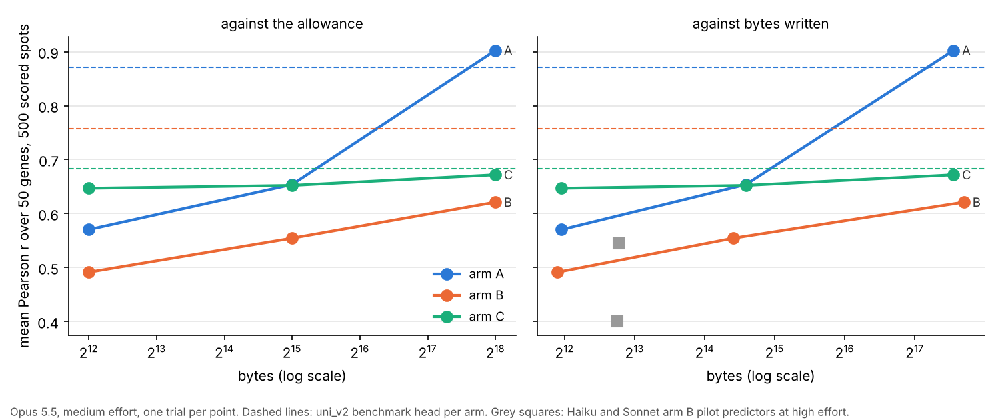

# Round 6, the cheatsheet track, final report at the C3 gate

12 October 2026. Written by the execution session for the oversight chat. It answers the C1 decision memo `docs/round06/i02/cheatsheet/round06_cheatsheet_C1_decisions.md`, including its revision of 02:20, and closes the track.

**The gate rule.** Report-and-wait means that no stage after the gated stage starts until the oversight chat has reviewed the report and replied. Not the dependent stages only, and not the expensive ones only. Every stage. Nothing after the gate is set up, staged or piloted. Inside an interval there are no interim reports and no interim stop conditions; anything that would have halted work is handled under the decision boundaries, recorded in an "Escalations" section of the next report, and work continues. Contact with anyone outside the project is never the session's decision.

**Read first.** Five points the oversight chat should check before the rest.
1. Arm A's large-size result is copying. The 262,144-byte writer for arms A and C encoded 43 image features and all 50 genes for every one of its spots, and the arm A predictor rebuilt the features of each scored patch and fitted a tree model on that table. In arm A the scored spots are in the table (section 6.4).
2. In arm C the combined session, which had all labelled spots in hand, scored below every arm C predictor that used a cheatsheet (section 6.1).
3. The work ran on branch `claude/beautiful-mccarthy-feog45`, not `round6-cheatsheet`, because this session's configuration names that branch (escalation E10).
4. The grid was first started before the writer prompt's revision of 02:20 had been fetched. The four writers it started were stopped within about a minute, before any wrote a cheatsheet, and none is counted (escalation E11).
5. Every C2 comparison with the pilot mixes effort with two prompt sentences the pilot did not have (section 4).

## 1. Stage and status

C2 and C3 are done, and the session has stopped at the C3 gate, the end of the track. All 20 grid sessions of the memo's section 3.4 ran once on Opus 5.5 at medium effort and ended with a valid output. None was excluded and none failed (`results/round6/cheatsheet/C2_grid/manifest.csv`). The analysis is in `results/round6/cheatsheet/C3_report/`.

## 2. What was run

- Interval 2 ran in a new container, `container_01YH5Tt446ni87y9nji7Gakc`, because the interval 1 container had been reclaimed. Section 5 of the instruction was followed to rebuild it, and the plan's section 1a records each step (`docs/round06/tracks/cheatsheet/round06_cheatsheet_plan.md`).
- The branch started from `main` at commit `31355f7`, with `main` at `c3af6f3` merged in for the prompt revision. The grid ran from commit `889c7f4`. The md5 of every script is in `results/round6/cheatsheet/C3_report/scripts_md5.csv`, and each run's command, commit and library versions are in `results/round6/cheatsheet/C2_grid/PROVENANCE.txt` and `results/round6/cheatsheet/C3_report/PROVENANCE.txt`.
- Claude Code 2.1.296. The trials saw numpy 2.5.3, pandas 3.0.5, scipy 1.18.1, Pillow 12.3.0, scikit-image 0.26.0 and scikit-learn 1.9.1, the same versions as the pilot (`results/round6/cheatsheet/C2_grid/PROVENANCE.txt`).
- The first trial started at 06:22:11 UTC and the last finished at 06:35:11 UTC, a span of 780 seconds with four trials at once. The 20 trials' own wall times sum to 2780.8 seconds (`results/round6/cheatsheet/C3_report/cost_totals.csv`).
- Trial counts by status are 20 done, 0 excluded and 0 failed (`results/round6/cheatsheet/C2_grid/manifest.csv`).
- Code changed for interval 2 as the memo requires. `round6_cheatsheet_child.py` takes the effort as a parameter, `round6_cheatsheet_prompts.py` carries the two new sentences, `round6_cheatsheet_scan.py` applies rule (b), and `round6_cheatsheet_run.py` records the effort, the rule and the per-trial counts. New scripts are `round6_cheatsheet_memwatch.py` (memory), `round6_cheatsheet_pilot_reread.py` (the pilot under rule (b)), `round6_cheatsheet_batch_push.sh` (after each batch) and `round6_cheatsheet_c3_analysis.py` (C3).
- Transcripts of the 20 trials and of the probe rerun are in `NicWYZ/hest-r6-data` under `transcripts/C2_grid/`, with their md5s in `results/round6/cheatsheet/C2_grid/transcripts_md5.csv` and `results/round6/cheatsheet/C2_grid/isolation_rerun/transcripts_md5.csv`.

## 3. Acceptance checks

- **Package.** All 20 md5s of the package in `NicWYZ/hest-r6-data` match its `MANIFEST.tsv`, which is identical to the committed `results/round6/cheatsheet/C0_package/MANIFEST.tsv`. The derived `axes.json` and `overview.json` rebuilt in the new container are identical to the committed copies in `results/round6/cheatsheet/C0_package/`.
- **Isolation, rerun on Opus at medium effort.** The I2 probe ran 22 turns and the I3 probe 9 turns, both served as `claude-opus-5-5` (`results/round6/cheatsheet/C2_grid/isolation_rerun/probes.csv`). No canary string appeared in any output or transcript (`results/round6/cheatsheet/C2_grid/isolation_rerun/canary_hits.csv`, empty). The filter refused `github.com`, `huggingface.co`, `pypi.org` and a telemetry host, and allowed only `api.anthropic.com` over the whole interval (the filter's log, kept in the container). The I2 report names the credential files, so it is kept private like interval 1's. The I3 report is `results/round6/cheatsheet/C2_grid/isolation_rerun/probe_reports/I3_d684a3b9_report.txt`. I1 was not rerun (section 8).
- **Prompts.** The four prompts were compared byte for byte with the instruction's revised section 6.3 after the merge of `c3af6f3`, and all four match. The command line of every running writer was checked for the new sentence after the restart.
- **Builder.** A dry build of each role and arm without a child gave 1741 writer spots in arms A and C, 814 in arm B, and 500 scored spots on the right slide, with no I4 blinding hit. These are the counts of `results/round6/cheatsheet/C0_package/package_summary.json`.
- **Rule (b).** Re-read under rule (a), the pilot's 19 transcripts reproduce interval 1's eight exclusions exactly, and the script stops if they do not. Under rule (b) none of the 19 is excluded (`results/round6/cheatsheet/C2_grid/pilot_reread_attempts.csv`).
- **Effort and model.** Every manifest row has `effort` medium, `scan_rule` b and served model `claude-opus-5-5` (`results/round6/cheatsheet/C2_grid/manifest.csv`).
- **Scores.** The prediction table has 350000 rows, 14 scored trials of 500 spots and 50 genes, and no trial predicted a constant gene (`results/round6/cheatsheet/C2_grid/predictions.parquet`, `results/round6/cheatsheet/C2_grid/scores.csv`, `results/round6/cheatsheet/C3_report/headline_values.csv`, where the row count was read back from the parquet).
- **Memory.** The container's used memory peaked at 2846588928 bytes, far under the 12 GB limit, so the grid ran four at once throughout (`results/round6/cheatsheet/C2_grid/memory.csv`).
- **Credentials.** Every cheatsheet, prediction file and manifest was scanned before each push. Only names of credential files and variables appear, in scripts and documents that already carry them on `main`. No credential-shaped string appears.

## 4. What differs between the arms of each comparison

**Arm A against arm B, at one size.** The writer's spots (all 1,741 S1 spots, including the 500 scored ones, against the 814 training-block spots), the writer's overview (the whole mosaic against the mosaic with held-out blocks white), and therefore the cheatsheet and the writer session. The predictor session also differs. The scored spots, their patches, the predictor prompt, the model and the effort are the same. At $b = 0$ the two arms share one baseline trial.

**Arm A against arm C, at one size.** The same cheatsheet. The scored slide (S1* against S2*, a second patient), whether the writer saw the scored spots (yes in A, no in C), the scored patches and the predictor session differ. The baselines differ too (one on S1*, one on S2*).

**Arm B against arm C, at one size.** The writer (training blocks against all of S1), the cheatsheet, the scored slide, the predictor session and the baseline.

**One size against the next, in one arm.** The writer session and its cheatsheet, the size in the prompt, the predictor session. Each size has its own writer, so a difference between sizes is also a difference between writers.

**Medium effort in C2 against the high-effort pilot, at one of Opus's four slots.** The effort level, the no-internet sentence in every prompt (memo 3.3), the sentence asking writers to use their allowance (revision of 02:20, writer and therefore the predictor that uses its file), the exclusion rule (b against a), the container, and the session. For the predictor slot the cheatsheet also differs, since its writer ran at the same effort as it. The pilot also ran two at once and C2 four at once.

## 5. Predictions against outcomes

Scored for Opus on single values, as memo section 4 says. From `results/round6/cheatsheet/C3_report/predictions.csv`.

| # | prediction | outcome | score |
|---|---|---|---|
| C.1 | At $b = 0$, Opus's $\bar r$ on S1* is between 0.05 and 0.35, and Haiku's is below Opus's | Opus at medium 0.427, at high 0.502. Haiku's value exists only at high effort | refuted |
| C.2 | In arm C no model reaches the `uni_v2` comparator on S2* at any finite size | Opus 0.647, 0.652 and 0.672 against 0.683 | held, by under 0.05 at 262,144 bytes |
| C.3 | In arm C Opus's combined session is above its own 262,144-byte value and below the `uni_v2` comparator | combined 0.581, 262,144 bytes 0.672, comparator 0.683 | partly held (below the comparator, not above the cheatsheet) |
| C.4 | In arm A no model reaches 0.8 at 32,768 bytes, and at least one reaches it at 262,144 bytes | 0.654 and 0.903 | held |
| C.5 | In arm B, $\bar r$ at 262,144 bytes is within 0.05 of its value at 32,768 bytes, and below arm A at 262,144 bytes | 0.554 and 0.621, a difference of 0.067; arm A 0.903 | partly held (the first clause fails) |
| C.6 | Replicate means ordered Opus, Sonnet, Haiku in two thirds of the pairs | only Opus ran in C2 | not tested |
| C.7 | At Opus's four pilot slots, medium is within 0.08 of high | baseline 0.427 against 0.502, predictor 0.554 against 0.600, combined 0.684 against 0.698. The writer slot has no score of its own | held, the baseline by under 0.01 |
| C.8 | Opus's cost per trial at medium is at most two thirds of high, over the four slots | ratio 0.43 against the rule (b) references, 0.36 against rule (a) | held |

## 6. Results

Every value is one trial. With one trial per cell, a difference under about 0.05 cannot be told from chance (C1 memo, section 4).

### 6.1 $\bar r$ against size, beside the comparators

From `results/round6/cheatsheet/C3_report/grid.csv`. Bytes are what the writer wrote. None exceeded its allowance, so nothing was cut.

| arm | $b$ | bytes written | $\bar r$ | `uni_v2` head | `hoptimus1` head | codebook |
|---|---|---|---|---|---|---|
| A | 0 | | 0.427 | 0.872 | 0.873 | |
| A | 4096 | 3976 | 0.570 | 0.872 | 0.873 | 0.794 |
| A | 32768 | 24647 | 0.654 | 0.872 | 0.873 | 0.909 |
| A | 262144 | 192612 | 0.903 | 0.872 | 0.873 | 1.000 |
| A | $\infty$ | | 0.924 | 0.872 | 0.873 | |
| B | 0 | | 0.427 | 0.757 | 0.754 | |
| B | 4096 | 3816 | 0.491 | 0.757 | 0.754 | 0.720 |
| B | 32768 | 21755 | 0.554 | 0.757 | 0.754 | 0.684 |
| B | 262144 | 213731 | 0.621 | 0.757 | 0.754 | 0.669 |
| B | $\infty$ | | 0.684 | 0.757 | 0.754 | |
| C | 0 | | 0.345 | 0.683 | 0.711 | |
| C | 4096 | 3976 | 0.647 | 0.683 | 0.711 | 0.594 |
| C | 32768 | 24647 | 0.652 | 0.683 | 0.711 | 0.609 |
| C | 262144 | 192612 | 0.672 | 0.683 | 0.711 | 0.598 |
| C | $\infty$ | | 0.581 | 0.683 | 0.711 | |

The benchmark head is fitted on the spots each arm's writer saw, so arm A's is in-sample. The codebook's centroids are not counted in its bytes. In every arm $\bar r$ rises with the allowance, and every cheatsheet beats its arm's baseline. Arm B stays below both benchmark heads at every size and at $\infty$. In arm C the three cheatsheet predictors sit within 0.04 of the `uni_v2` head (0.647 to 0.672 against 0.683) and above the codebook at every size, while the combined session, with all 1,741 labelled spots and their images, scored 0.581 (`results/round6/cheatsheet/C3_report/headline_values.csv`).

The figure is `results/round6/cheatsheet/C3_report/rbar_vs_bytes.png`. Writers at 32,768 bytes now wrote 21,755 and 24,647 bytes, against the pilot's 6,892 to 17,688 (`results/round6/cheatsheet/C3_report/headline_values.csv`, `results/round6/cheatsheet/C3_report/grid.csv`, `results/round6/cheatsheet/C3_report/pilot_reference_points.csv`, `results/round6/cheatsheet/C3_report/effort.csv`). At 262,144 bytes they wrote 192,612 and 213,731. So the allowance was used, and the two panels of the figure differ little.

### 6.2 $b^*$ as brackets

From `results/round6/cheatsheet/C3_report/bstar.csv`. With one replicate, $\bar r(b)$ is that trial's value.

| arm | $b^*(0.8)$ | $b^*$ at the `uni_v2` head | $b^*$ at the `hoptimus1` head | codebook reaches 0.8 | codebook reaches the `uni_v2` head |
|---|---|---|---|---|---|
| A | (32768, 262144] | (32768, 262144] | (32768, 262144] | first at 32768 | first at 32768 |
| B | not reached | not reached | not reached | not reached | not reached |
| C | not reached | not reached | not reached | not reached | not reached |

Arm A's bracket comes from the copying described in 6.4. In arms B and C no cheatsheet up to 262,144 bytes, and no combined session, reached the benchmark head fitted on the same spots.

### 6.3 Differences between arms

From `results/round6/cheatsheet/C3_report/arm_differences.csv`. Section 4 lists what differs.

| $b$ | A − B | A − C | B − C |
|---|---|---|---|
| 0 | 0.000 | 0.082 | 0.082 |
| 4096 | 0.079 | −0.077 | −0.156 |
| 32768 | 0.099 | 0.002 | −0.098 |
| 262144 | 0.281 | 0.231 | −0.051 |
| $\infty$ | 0.240 | 0.343 | 0.103 |

A − B grows from 0.079 at 4,096 bytes to 0.281 at 262,144, which is where the arm A writer could list every scored spot. A − C is near zero at 32,768 bytes (0.002) with the same cheatsheet, so at that size the spots its writer had seen and a second patient's spots scored alike, although the slides differ as well as the writer's view of them. Arm C, scored on another patient, sits above arm B at every finite size, by 0.156 at 4,096 bytes (`results/round6/cheatsheet/C3_report/headline_values.csv`). Its writer saw all of S1 rather than half, and its baseline is lower (0.345 against 0.427), so the cheatsheet adds more in arm C.

### 6.4 What the cheatsheets contain

Tags by script are in `results/round6/cheatsheet/C3_report/cheatsheet_tags.csv`, for the six C2 cheatsheets and the pilot's three. Every cheatsheet was read in full or in its sections to check the tags, and they hold.

- **4,096 bytes (both writers).** Prose describing five or six visual classes, a table of the 50 genes' means per class, rules keyed to visual features (white fraction, lymphocytes, pigment, vessels), and gene modules. No code.
- **32,768 bytes (both writers).** The same, plus feature-extraction code in Python. The arm B writer adds ridge coefficients on 12 image features. The arm A and C writer adds prototype profiles and a nearest-prototype weighting rule.
- **262,144 bytes, arm A and C writer (`8cd478c7`).** Prose, class tables and code as above, and then a table of all 1,741 spots. Each row holds 43 image features and 50 gene values, encoded at one character each. It is tagged as holding values keyed to individual patches, because the features act as an image fingerprint.
- **262,144 bytes, arm B writer (`c381fe74`).** The same design for its 814 training spots, with 22 image features, a class label and the 50 genes per row, plus per-class quantiles and per-feature class means.

The arm A predictor at 262,144 bytes decoded the table, computed the same 43 features on its patches and fitted the extra-trees model the cheatsheet recommended (the trial's final message, in its transcript). Because the 500 scored spots are rows of that table, this is a look-up of the scored spots, and its 0.903 measures copying, not learning. The arm C predictor ran the same pipeline on S2* and then adjusted predictions by eye for the different staining, reaching 0.672.

$\bar r$ by tag, where counts allow. All nine cheatsheets carry prose, visual-feature numbers and per-class values. Code or coefficients are in six. Values keyed to individual patches are in two, both at 262,144 bytes, so this tag and the largest size cannot be separated with these data (`results/round6/cheatsheet/C3_report/cheatsheet_tags.csv`).

### 6.5 Medium against high effort at Opus's four pilot slots

From `results/round6/cheatsheet/C3_report/effort.csv`. "High" is the first pilot attempt passing rule (b), with the rule (a) value beside it where it differs.

| slot | $\bar r$ medium | $\bar r$ high | cost medium (US dollars) | cost high | turns medium / high | wall seconds medium / high |
|---|---|---|---|---|---|---|
| baseline, $b = 0$ | 0.427 | 0.502 | 0.285 | 1.023 | 15 / 38 | 111.1 / 310.8 |
| writer, arm B, 32,768 | | | 0.852 | 1.446 | 23 / 45 | 190.7 / 504.6 |
| predictor, arm B, 32,768 | 0.554 | 0.600 | 0.279 | 0.855 | 8 / 32 | 51.5 / 174.1 |
| combined, arm B | 0.684 | 0.698 (rule a 0.705) | 0.139 | 0.313 (rule a 0.997) | 7 / 13 | 101.6 / 391.3 |

Medium effort scored lower at all three scored slots, by 0.075, 0.046 and 0.014 against the rule (b) references. Only the baseline's difference is above the 0.05 that one trial per slot cannot resolve, and it is still within C.7's 0.08. So these data do not show that medium effort costs accuracy, and they cannot rule out a loss of about 0.05. The writer at medium wrote 21,755 bytes against the pilot writer's 17,688, under a prompt that asked it to use its allowance. Section 4 lists the other differences.

Haiku's and Sonnet's high-effort pilot values, as reference points (`results/round6/cheatsheet/C3_report/pilot_reference_points.csv`). Haiku's baseline is 0.260 under rule (a) and 0.186 under rule (b), its arm B predictor at 32,768 bytes 0.545, and its combined session 0.675 under rule (b), where rule (a) left the slot empty. Sonnet's are 0.339, 0.400 and 0.669.

### 6.6 Refused network attempts and listings outside the trial directory

From `results/round6/cheatsheet/C3_report/scan_counts.csv`. Every trial has zero refused network attempts, zero paths outside its directory other than system folders, and zero references to the credential folder. The only hits are system paths, between 2 and 49 per trial, mostly scripts the agent wrote to `/tmp`. The added no-internet sentence coincides with the pilot's network attempts disappearing, though the pilot's were mostly Haiku's. One combined session (arm C) tried to place the target patches on the overview by matching pixels. It found the true location of every labelled patch it tested, matched none of the target patches, and fell back to image features (the trial's final message). This is a use of the overview the design allows, and in arm C it cannot succeed because the targets are from another slide.

### 6.7 Cost, tokens and wall time

From `results/round6/cheatsheet/C3_report/cost_by_role.csv`. Costs are Claude Code's estimates at API prices.

| role | trials | cost (US dollars) | per trial | C1 per trial at high | ratio | output tokens | wall seconds per trial | C1 wall per trial |
|---|---|---|---|---|---|---|---|---|
| baseline | 2 | 0.458 | 0.229 | 1.023 | 0.22 | 12476 | 87.85 | 310.8 |
| writer | 6 | 3.986 | 0.664 | 1.446 | 0.46 | 85818 | 226.05 | 504.6 |
| predictor | 9 | 2.801 | 0.311 | 0.855 | 0.36 | 42669 | 65.9 | 174.1 |
| combined | 3 | 0.661 | 0.220 | 1.310 | 0.17 | 18194 | 218.57 | 2320.1 |

The grid cost 7.91 US dollars in total, against 22.35 that the C1 projection gives for these 20 sessions at high effort (`results/round6/cheatsheet/C3_report/cost_totals.csv`). Its 20 trials took 2780.8 seconds of wall time between them, against 12176.4 projected, and 780 seconds from first start to last finish.

## 7. Discrepancies, open questions and escalations

### Escalations

- **E10. Branch name.** The instruction names `round6-cheatsheet`. This session's own configuration requires branch `claude/beautiful-mccarthy-feog45`, so C2 and C3 are there, created from `main` at `31355f7` (plan flag F17). The C1 memo is on it unchanged, from `main`. Nicolas can rename the branch before merging if he prefers. The tag `round6-cheatsheet-final` points at this branch's last commit.
- **E11. Four writers started before the prompt revision was fetched.** The grid first started at 06:20 UTC from commit `b661d1e`, without the sentence of 02:20. Nicolas asked the session to check `main` for prompt edits, and the runner and its four writers (`1586411e`, `5d97cece`, `bea5ffb5`, `f14e17ab`) were stopped about a minute after they started. None had written a cheatsheet, and no manifest row exists for them. They are handled as interrupted trials under instruction section 5. Their directories and logs are kept privately and their transcripts were not pushed. `results/round6/cheatsheet/C2_grid/PROVENANCE.txt` keeps the entry of that start (plan flag F20).
- **E12. The container was rebuilt.** The interval 1 container had been reclaimed, so packages were reinstalled, the package restaged and checked, the filtering proxy and its `start.sh` rewritten (the script had not been committed in interval 1), and I2 and I3 rerun, as section 5 of the instruction says (plan section 1a, flag F18).
- **E13. How rule (b) reads "credential contents".** The scanner does not read the credential files, so it cannot match their exact contents. It excludes credential-shaped strings and any tool call that reads a file inside the credential folder, and records listings and file names without excluding (plan flag F19). No C2 trial touched the folder.
- **E14. Arm A at 262,144 bytes is a look-up of the scored spots** (section 6.4). This is the copying that arm A was designed to expose, and the report reads it as such.
- **E15. The overview is a mosaic of patches,** not a scan of the section (C1 report E2, memo 3.6).
- **E16. Both slides are public 10x datasets from 2023,** certainly in the models' training data as datasets. The trials had no network beyond the API (section 3).

### Discrepancies and smaller points

- The memory log's `running_trials` column counts bubblewrap processes, two per trial, so it reads 8 when four trials run (`results/round6/cheatsheet/C2_grid/memory.csv`).
- `matplotlib` was installed with `pip` after the last trial, for the figure. The trials did not have it.
- The numeric-claim sweep over the track's documents finds two values in the instruction's revision line of 02:20 that are not in the cited manifest. It gives the pilot writers' sizes as 6,890 to 17,690 bytes, and `results/round6/cheatsheet/C1_pilot/manifest.csv` holds 6892 and 17688 at the two ends. The C1 memo's revision quotes them correctly. The instruction is the oversight chat's file and is left as it is. The memo's 4.32 US dollars is a sum of four values in `results/round6/cheatsheet/C1_pilot/c1_by_model_role.csv`, which the sweep does not compute.
- The pilot re-read under rule (b) gives Opus's combined reference as 0.698 from its first attempt, against 0.705 counted under rule (a), and Haiku's baseline as 0.186 against 0.260 (`results/round6/cheatsheet/C2_grid/pilot_reference.csv`).

### Open questions for the memo

1. Whether to keep the branch name or rename it to `round6-cheatsheet` before the merge.
2. Whether arm A's 262,144-byte value should be reported in the round's summary at all, or only as the copying check it is.

## 8. What was not checked

- The I1 probe was not rerun in the new container. I1 rests on interval 1's probe and on every C2 trial's init event, which lists the same six tools and no MCP servers.
- Replication. Every cell is one trial, so no variance between replicates is estimated.
- Per-gene results are in `results/round6/cheatsheet/C2_grid/per_gene_scores.csv` and are not analysed here.
- The cheatsheets' visual class descriptions were not checked against the images.
- Whether the arm C predictor's correction by eye helped. Its pipeline before the correction was not scored separately.
- How the costs map to Nicolas's usage limits.

## 9. Proposed next step

The track is complete. The oversight chat reviews this report and writes the closing memo. Nothing further is set up.

## What the cheatsheet experiment established

Opus 5.5 at medium effort, given only H&E patches, predicted 50 genes at $\bar r$ 0.427 on held-out spots of the training slide and 0.345 on a second patient (`results/round6/cheatsheet/C3_report/grid.csv`). A text cheatsheet written by another Opus session that had seen measured expression raised this at every size tried, up to 0.621 on held-out spots of the same slide and 0.672 on the second patient at 262,144 bytes (`results/round6/cheatsheet/C3_report/grid.csv`). On the second patient the gain was already 0.302 at 4,096 bytes and grew little after that, so most of the benefit came from class descriptions and per-class gene means that fit in about 4 kB (`results/round6/cheatsheet/C3_report/grid.csv`, `results/round6/cheatsheet/C3_report/headline_values.csv`, `results/round6/cheatsheet/C3_report/cheatsheet_tags.csv`). In neither unseen setting did any cheatsheet, or a session holding every labelled spot, reach the benchmark head on `uni_v2` embeddings fitted on the same labelled spots (0.757 and 0.683), though on the second patient the best cheatsheet came within 0.011 of it, inside the noise of one trial (`results/round6/cheatsheet/C3_report/grid.csv`, `results/round6/cheatsheet/C3_report/headline_values.csv`, `results/round6/cheatsheet/C3_report/bstar.csv`). The only setting above the benchmark head was the one where the writer had seen the scored spots and, at 262,144 bytes, listed each of them with an image fingerprint, which is copying (`results/round6/cheatsheet/C3_report/cheatsheet_tags.csv`, `results/round6/cheatsheet/C3_report/grid.csv`). The large cheatsheets turned into training sets with feature-extraction code, so at that size the predictor was running a small hand-built image model, not reading the slide (`results/round6/cheatsheet/C3_report/cheatsheet_tags.csv`). Medium effort cost 0.43 times what high effort cost at Opus's four pilot slots and scored lower by 0.014 to 0.075, differences that one trial per slot cannot separate from chance except at the baseline (`results/round6/cheatsheet/C3_report/effort.csv`, `results/round6/cheatsheet/C3_report/headline_values.csv`). Every value here is a single trial on one pair of slides from one cancer type, so these are readings, not established effect sizes (`results/round6/cheatsheet/C2_grid/manifest.csv`).
