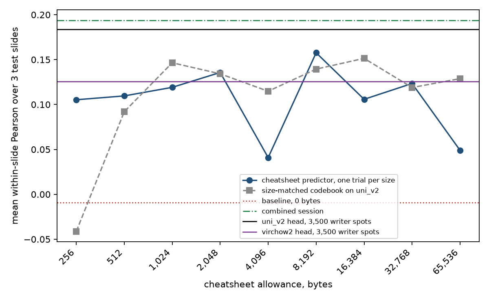

# Biological cheatsheets for predicting expression on new patients

13 October 2026. A short summary of the extension of the cheatsheet experiment, in the form of the earlier summary (`round06_cheatsheet_summary.md`).

## The question

The first experiment found that, on a second patient, about 4 KB of class descriptions and gene means carried most of what a cheatsheet could pass on, and that larger cheatsheets turned into code and training tables. The extension asks a narrower question with more data. How much of the link between tissue appearance and expression can be passed on as biological text that holds for new patients, and does prediction grow with the size of that text?

## Design

**Data.** HEST-bench's clear cell renal cell carcinoma task (CCRCC, 10x Visium), the only task with at least 10 slides from different patients. Only its FFPE slides are used, since its frozen sections look different under H&E. Ten were drawn by a fixed random seed. Seven patients train the writers and three are held out for testing. Each slide contributes a stratified sample of 500 spots, so writers see 3,500 labelled spots and predictors are scored on 1,500.

**Writer and predictor.** As before, each is a fresh, separate agent, and the cheatsheet is the only channel from the measurements to the predictions.

**A rubric for the cheatsheet.** A cheatsheet may describe tissue in histological terms, give gene levels for each kind of tissue, describe gradients that can be judged by eye, gene modules, how patients differ by appearance, and cautions. It may not contain code or model recipes, image measurements that need a computer, anything tied to a particular training spot or patient, or advice about scoring. A separate checker agent audited every cheatsheet against the rubric. Violations went back to the writer for revision.

**Sizes.** $b \in \{0\} \cup \{2^{8}, 2^{9}, \ldots, 2^{16}\}$ bytes, from 256 bytes to 64 KB, with $b = 0$ as the image-only baseline. A combined session that holds the labelled spots and the target images together gives the reference with no text bottleneck.

**Comparators.** The benchmark's prediction head (PCA to 256 components, then ridge regression) on `uni_v2` and `virchow2` embeddings, fitted on the same 3,500 spots, and a size-matched codebook.

## Method

For test patient $s$ and gene $g$, with measured values $y_{sg}$ and predictions $\hat y_{sg}$ over that patient's 500 spots, accuracy is the within-patient mean Pearson correlation averaged over the three test patients,

$$
\bar r = \frac{1}{3}\sum_{s=1}^{3} \frac{1}{50}\sum_{g=1}^{50} \operatorname{corr}\big(\hat y_{sg},\, y_{sg}\big).
$$

A correlation pooled across patients would also reward getting each patient's overall level right, which a within-patient correlation ignores, so the pooled value is reported only beside this one.

## Implementation

- Claude Opus 5.5 at medium effort, one run per size. With the audits and three revisions, 35 sessions ran, taking 56 minutes of session time between them and costing about 16 US dollars.
- Every session ran confined to its own folder in a container on Nicolas's Mac, and could reach nothing on the network except the model's API. Deliberate attempts to read other files or reach other hosts all failed.

## Results

| | $\bar r$ |
|---|---|
| image only ($b = 0$) | −0.01 |
| cheatsheet, 256 bytes | 0.11 |
| cheatsheet, 512 bytes | 0.11 |
| cheatsheet, 1 KB | 0.12 |
| cheatsheet, 2 KB | 0.14 |
| cheatsheet, 4 KB | 0.04 |
| cheatsheet, 8 KB | **0.16** |
| cheatsheet, 16 KB | 0.11 |
| cheatsheet, 32 KB | 0.12 |
| cheatsheet, 64 KB | 0.05 |
| labelled spots in hand, no text limit | 0.19 |
| benchmark head, `uni_v2`, same 3,500 spots | 0.18 |
| benchmark head, `uni_v2`, all 31,075 training spots | 0.22 |

1. **From images alone the model predicts nothing here.** The zero-shot baseline scored −0.01, against 0.35 on the melanoma task.
2. **Any cheatsheet helps, and its size does not matter.** All nine cheatsheets beat the baseline. Accuracy does not rise with size (rank correlation −0.02 over the nine sizes), and 248 bytes reached 0.11.
3. **No cheatsheet reached the pathology model.** The best, at 8 KB, scored 0.16 against 0.18 for the `uni_v2` head on the same spots.
4. **The curve's ups and downs are within noise.** Seven sizes lie within about 0.05 of each other, about as much as the codebook moves across sizes from 512 bytes up with no agent involved. The two low sizes, 4 KB and 64 KB, cannot be told from a poor run with one trial each.
5. **The rubric held.** No cheatsheet contained code, a model recipe or a computed measurement. Three writers failed one audit each, with five violations in all, mostly for using stain colour as a cue, and each fixed them in one revision.
6. **An agent with the data in hand matched the pathology model.** The combined session scored 0.19 by fitting a model on image features it built itself, level with the `uni_v2` head within noise.

## Discussion

**Why size does not help.** Every cheatsheet carries one message that fits in a few hundred bytes. Expression rises and falls with how much cellular tissue is in the spot. From about 1 KB up, the writers spent the extra bytes describing five to seven "section types" with their gene levels, which are in effect the seven training patients described by appearance. The rubric allows this. But a patient's overall level is the same for all of its spots, so it does not help rank spots within a patient, which is what the metric measures. The predictors used the section types to set one level per test patient and the cellularity rule to vary it across spots.

**Language model against pathology model.** On this task, biological text did not let a general-purpose model match a frozen pathology encoder given the same labelled spots. The gap is small, and the encoder itself does poorly here, at 0.18. The pilot's writer found that most of these 50 genes have zero counts in 45 to 70% of spots, and that they vary little with what can be seen inside one section.

**Comparison with the first experiment.** On melanoma, the 4 KB cheatsheet reached 95% of the head's value on a new patient and the best reached 98%. Here the best reached 86%, on a task where both start much lower. The two tasks differ in tissue, platform, number of patients and the rubric, so the comparison is only indicative.

**Limits.** Every value is a single trial, so differences under about 0.05 are within noise. One test slide, `INT24`, was less representative of its section than the sampling rule allowed. The slides are public and may be in the model's training data as a dataset, although no session could reach the network.

**Not pursued further.** The extension gives no reason to expect that a language model with a cheatsheet, biological or not, would outperform the pathology encoders. The project returns to prediction-powered inference.
